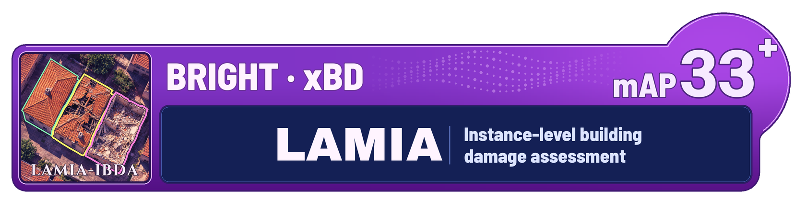

# LAMIA: Language-guided Adaptive Multimodal Integration and Alignment

LAMIA is a vision-language framework for **instance-level building damage assessment**. Given pre- and post-disaster remote sensing images of the same area, it predicts a bounding box, an instance mask, and a damage class for each building. This repository provides training, evaluation, and single-pair inference scripts for BRIGHT and xBD.

LAMIA uses a bitemporal PVT-v2 backbone, an FPN, and a three-stage cascade detection head. Adaptive Text–Visual Alignment (ATVA) adapts representations of damage descriptions based on local regions in the two images. Dynamic Instance Prototype Grounding (DIPG) aggregates the corresponding text prototypes for each building proposal to distinguish damage levels.

[News](#news) · [Installation](#installation) · [Training, Evaluation, and Inference](#training-evaluation-and-inference)

## News

- **2026.11.24** — Our paper was avaliable on arXiv. [Beyond Static Semantics: Instance-Adaptive Vision-Language Alignment for Building Damage Assessment](http://arxiv.org/abs/2611.32777)

## Installation

For a new environment, we recommend Python 3.12, PyTorch 2.4.0, torchvision 0.19.0, and CUDA 12.1. Run the following commands from the repository root.

```bash
conda create -n lamia python=3.12
conda activate lamia
pip install torch==2.4.0 torchvision==0.19.0 torchaudio==2.4.0 --index-url https://download.pytorch.org/whl/cu121
pip install -r requirements.txt
```

If you already have a compatible PyTorch and torchvision environment, run the last command to install the remaining dependencies.

## Training, Evaluation, and Inference

### Data Preparation

For the default configuration, organize the datasets and checkpoints as shown below.

```text
data/
├── BRIGHT/
└── xBD/
checkpoints/
├── bge_small_en/
└── pvt_v2_b3.pth
config/
mm/
tools/
```

You can also edit `config/_base_/paths.py` to point to your own locations.

### Preparing the Datasets

Organize the bitemporal images and instance annotations as shown below.

```text
<dataset_root>/
├── train_annotations.json
├── valid_annotations.json
├── test_annotations.json
├── train/
│   ├── pre_event/
│   │   └── image_001.tif
│   ├── post_event/
│   │   └── image_001.tif
│   └── target/
│       └── image_001.tif
├── valid/
│   ├── pre_event/
│   └── post_event/
└── test/
    ├── pre_event/
    └── post_event/
```

You can set `<dataset_root>` in `config/_base_/paths.py`. It defaults to the `data` directory under the repository root. The `*_annotations.json` files must use the COCO instance annotation format and contain building bounding boxes, polygon segmentation masks, and categories. The `target` directory contains the pixel-level labels used for training. Label `0` denotes background, labels `1…N` correspond to the damage classes, and label `255` marks regions to ignore. The `valid` split is used for validation during training. You can prepare it yourself or use `tools/split_train_valid.py` to create it from the training set.

```bash
python tools/split_train_valid.py /path/to/dataset/root
```

The script automatically creates the `valid` directory. Use `--valid-ratio` to set the validation fraction (between 0 and 1, default 0.2) and `--seed` to set the random seed (default 42).

### Preparing the Checkpoints

Prepare the following checkpoints before training.

- [bge-small-en](https://huggingface.co/BAAI/bge-small-en/tree/main)
- [pvt-v2-b3](https://github.com/whai362/PVT#model-zoo)

You can set the paths for the two checkpoints in `config/_base_/paths.py`. The defaults are `checkpoints/bge-small-en` and `checkpoints/pvt-v2-b3.pth`, respectively.

To use our trained model for evaluation or inference, download the LAMIA weights using the links below.

- [Google Drive](https://drive.google.com/drive/folders/1OqMuvXcpn0625xNpa4YQYZdEDDsa2Q9B)
- [Baidu Netdisk](https://pan.baidu.com/s/1n_Cyb--0bss193ANfaHT5Q) (password: 43by)

### Training

The following examples use BRIGHT. To train on a single GPU, run the following command.

```bash
python tools/train.py config/lamia_bright.py
```

To run distributed training on multiple GPUs, use the following command.

```bash
bash tools/dist_train.sh config/lamia_bright.py 4
```

Use `--work-dir` to set the output directory. The default is `./work_dirs/<config_name>/<timestamp>`. After an interruption, use `--resume` to continue from the latest checkpoint in that directory, or use `--resume /path/to/*.pth` to specify a checkpoint. Training runs for 100 epochs by default and selects the best checkpoint by COCO mask AP (`coco/segm_mAP`) on the validation set.

### Evaluation

Run the following command to evaluate LAMIA on the BRIGHT test set. Replace `/path/to/lamia_bright.pth` with the path to your BRIGHT checkpoint.

```bash
python tools/test.py config/lamia_bright.py /path/to/lamia_bright.pth
```

The script uses the test images and COCO annotations specified in the configuration and reports COCO metrics for bounding boxes (`coco/bbox_mAP`) and instance masks (`coco/segm_mAP`).

### Inference

The inference script accepts either a pair of pre- and post-disaster images of the same area or two directories containing paired images. When using directories, the filenames must match one-to-one.

```bash
python tools/infer.py config/lamia_bright.py /path/to/lamia_bright.pth \
    /path/to/pre_event.tif /path/to/post_event.tif \
    --out-dir work_dirs/lamia_bright/inference --visualize
```

If you omit `--out-dir`, the script writes results to `work_dirs/<config_name>/<timestamp>`. Use `--visualize` to generate visualizations. To change the colors used for each class, open `config/_base_/dataset/bright.py` and edit `metainfo.palette`.

### Selecting GPUs

On a machine with multiple GPUs, use `CUDA_VISIBLE_DEVICES` to select which GPUs to use for training, evaluation, or inference. The following commands show how to select GPUs for training.

```bash
CUDA_VISIBLE_DEVICES=7 python tools/train.py config/lamia_bright.py
CUDA_VISIBLE_DEVICES=2,3,4,5 bash tools/dist_train.sh config/lamia_bright.py 4
```

## Acknowledgments

This project uses MMCV, MMDetection, and MMEngine from OpenMMLab. Third-party licenses are retained in their respective directories. [MMCV](mm/cv/LICENSE) · [MMDetection](mm/det/LICENSE) · [MMEngine](mm/engine/LICENSE)
